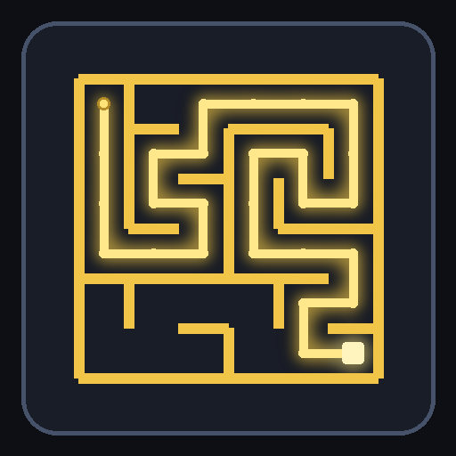

# Maze Generator v3.1

A fully in-game **runtime maze generator** datapack for Minecraft Java Edition. Click a button and a complete maze builds itself right in front of you — no mods, no tools, no setup.

Built with recursive-division, generated live in your world, and it can go **huge**: rectangle mazes up to 100,000 blocks per side.

## Features

- 🟨 **Rectangle mazes** — set Width (X) and Height (Z) independently, from 8 up to 100,000 blocks
- 🛤️ **Corridor width** — 1 up to 100,000 blocks per passage
- 📏 **Wall height** — 3, 5, 8, or any value from 1 to 16
- 🧱 **Wall thickness** — 1, 2, 3, or 4 blocks thick
- 🏠 **Roof modes** — Wool roof, no roof, or an invisible Barrier plane
- ✨ **Glowing solution path** — toggle a glowstone route leading from the entrance to the exit
- 🧹 **Clear Area** — removes everything the generator placed so you can rebuild in place
- 🖱️ **Two interfaces** — a click-everything chat menu, and a written book for your inventory

## Installation

1. Download this repository (or the latest release zip)
2. Drop the `maze_datapack` folder into your world's `datapacks` folder
   - Singleplayer: `.minecraft/saves/<world>/datapacks/`
   - Server: `<server>/<world>/datapacks/`
3. Run `/reload` in-game — you'll see `[Maze Gen] v3.1 loaded` in chat

## Usage

1. Stand where you want the maze's corner — it builds 2 blocks into the +X/+Z direction from you
2. Run `/function mazegen` to open the menu
3. Click a preset — or `[Custom]` and then `/trigger mz_custom_size set <number>`
4. Click **[BUILD MAZE HERE]** and watch it build
5. Prefer a book? Click **[BOOK]** — every setting is a clickable button in there too

Every click refreshes the menu, so the "Current" line always shows exactly what will build.

## Settings at a glance

| Setting | Presets | Range |
|---|---|---|
| Width (X) | 16 / 32 / 64 | 8 – 100,000 |
| Height (Z) | 16 / 32 / 64 | 8 – 100,000 |
| Corridor width | 1 / 2 / 3 | 1 – 100,000 |
| Wall height | 3 / 5 / 8 | 1 – 16 |
| Wall thickness | 1 / 2 / 3 | 1 – 4 |
| Roof | Wool / Off / Barrier | — |
| Solution path | On / Off | — |

## Tips

- Large mazes build progressively — watch the action bar for progress
- **[CLEAR AREA]** only removes the generator's own blocks (floor, walls, wool, glowstone, barriers)
- If a maze looks sealed, the glowstone doorways are on the X edges — toggle the solution path to see the route
- Huge sizes (thousands of blocks) take a while and are meant for creative worlds; the generator chunks its work so the game stays responsive

## Compatibility

- **Minecraft Java Edition 1.21.5 – 26.3** (data pack format 71 – 200)
- Developed and tested on **26.3**
- Vanilla only — works in singleplayer and on multiplayer servers
- Uses its own `mz_*` scoreboard objectives, so it won't clash with other datapacks

## Credits

Made by **Near**.
